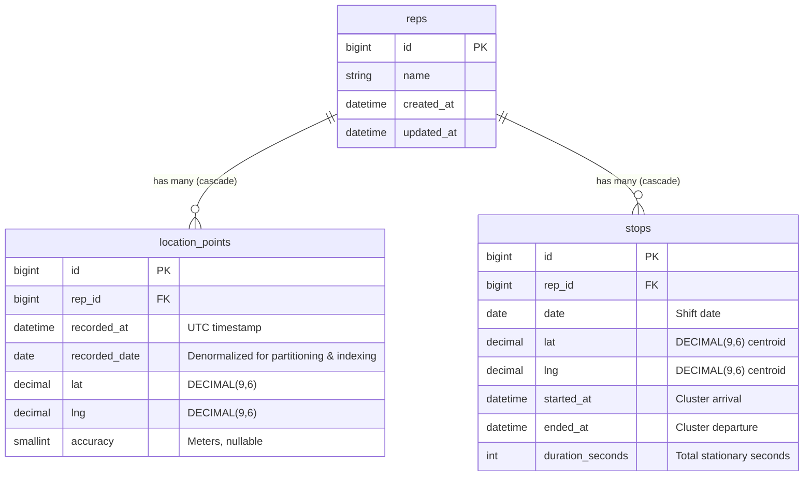

# Sales Representative Location Tracking System

A high-throughput, fault-tolerant geospatial tracking backend built with **PHP 8.2+** and **Laravel 12**. The system ingests continuous GPS streams from mobile devices carried by field sales representatives, provides zero-data-loss guarantees, computes stationary stop reports, evaluates polygon zone dwell times, and serves an interactive Leaflet + OpenStreetMap daily tracking playback.

---

## 1. System Architecture

```mermaid
flowchart TD
    subgraph Mobile Devices
        MD[Field Rep Mobile App]
        LB[Local SQLite Buffer]
        MD -->|Continuous GPS (10-30s)| LB
        LB -->|Bulk HTTP POST /api/v1/locations/batch| ING
    end

    subgraph Ingestion Layer
        ING[LocationBatchController]
        REQ[StoreLocationBatchRequest]
        REP[LocationPointRepository]
        ING -->|Validate| REQ
        ING -->|insertOrIgnore chunks| REP
        REP -->|Raw Points Table| DB_RAW[(MySQL location_points)]
        ING -->|202 Accepted + Dispatch| Q[(Database Queue)]
    end

    subgraph Async Processing
        Q --> W[Queue Worker]
        W --> CSJ[ComputeStopsJob]
        CSJ --> REP
        CSJ --> SD[StopDetector Engine]
        SD -->|Precomputed Stops| DB_STOPS[(MySQL stops)]
    end

    subgraph Query & Analytics Layer
        SRC[StopReportController]
        ZRC[ZoneReportController]
        DVC[RepDayViewController]
        
        SRC -->|Read Precomputed / On-Demand| DB_STOPS
        ZRC -->|Step 1: BBox Index Filter| DB_RAW
        ZRC -->|Step 2: Stream Full Day Points| ZA[ZoneAnalyzer Engine]
        DVC -->|Ramer-Douglas-Peucker| TS[TrackSimplifier]
        DVC -->|Render| MAP[Leaflet + OSM Playback Map]
    end
```

### Architectural Highlights
- **At-Least-Once Delivery & Idempotency**: The mobile client stores GPS points in a local database and only purges them after a successful `202 Accepted` response. If a network blip occurs, the device resends the batch. The server applies MySQL `INSERT IGNORE` with a unique constraint on `(rep_id, recorded_at)`, rendering duplicate submissions completely safe and idempotent.
- **Decoupled Ingestion & Computation**: Ingestion is synchronous and lightning-fast (bulk batch inserts). Stop detection runs asynchronously via queued background jobs (`ComputeStopsJob`), keeping API response latencies minimal (<30ms).
- **Two-Tier Query Strategy**: Read endpoints utilize precomputed tables where possible, while falling back to real-time streaming computation if requested for current/unprocessed days.

---

## 2. Data Model & Index Design



### Rationale for Schema Design
1. **`location_points` Storage Optimization**:
   - `lat` and `lng` use `DECIMAL(9,6)`: Provides precision down to ~0.11 meters (11 cm), perfectly suited for walking street-level accuracy while consuming only 5 bytes per coordinate (10 bytes total), compared to 16 bytes for `DOUBLE`.
   - `recorded_date` (DATE): Denormalized from `recorded_at` to eliminate expensive runtime date functions (e.g., `DATE(recorded_at)` prevents index usage).
   - No `created_at` / `updated_at`: Omission of standard Laravel timestamps saves 16 bytes per row. For 10 million rows, this directly saves ~160 MB of storage and index overhead.
   - `accuracy` (UNSIGNED SMALLINT): 2 bytes, tracks GPS accuracy in meters.
2. **Indexing Strategy**:
   - `UNIQUE(rep_id, recorded_at)`: Enforces idempotency for re-sent device payloads and prevents duplication.
   - `INDEX(rep_id, recorded_date, recorded_at)`: Enables instant range scans for daily rep tracks, chronological order queries, and streaming cursor pagination.
   - `INDEX(recorded_date, lat, lng)`: Crucial for the Zone Report. Filters potential candidates inside a rectangular bounding box using a compound B-Tree index before executing detailed ray-casting algorithms.
3. **`stops` Derived Table**:
   - `INDEX(rep_id, date)`: Instant $O(1)$ lookup for daily Stop Reports without scanning millions of raw points.
   - `UNIQUE(rep_id, started_at)`: Prevents duplicate stop records upon job retries.

---

## 3. Zero Data Loss vs. Storage Optimization

Balancing uninterrupted fidelity (zero data loss) with high-volume geographical storage demands a multi-tiered data lifecycle:

| Concern | Implementation in System |
| :--- | :--- |
| **Zero Data Loss** | Mobile client local storage + retry with exponential backoff; Server uses `insertOrIgnore` on `UNIQUE(rep_id, recorded_at)`. No point is ever dropped or downsampled upon ingestion. |
| **Row Density** | Compact native data types (`DECIMAL(9,6)`, `SMALLINT`, `DATE`), elimination of redundant framework timestamps, resulting in ~35-40 bytes per raw point on disk. |
| **Query Acceleration** | Pre-filtering candidate sales reps through spatial bounding boxes using composite indexes `(recorded_date, lat, lng)` before CPU-intensive polygon math. |
| **Memory Efficiency** | Streaming queries via Laravel `LazyCollection` (`cursor()`) ensure constant memory footprint ($O(1)$ RAM) even when processing millions of coordinate points. |
| **Derived Caching** | High-level business events (e.g., stationary stops) are materialized into the `stops` table so read queries don't re-calculate raw geometry. |
| **Track Simplification** | For map visualizations, the Ramer-Douglas-Peucker (RDP) algorithm compresses displayed track vertices by **~75-90%**, preserving bandwidth and browser rendering speed while retaining exact stops and sharp turns. |

### Optional: MySQL Partitioning by Range
In high-volume enterprise production deployments (e.g., millions of points per week), MySQL table partitioning by `recorded_date` allows instant partition drops for data retention and partition pruning for queries:

```sql
-- NOTE: In MySQL, every UNIQUE key must include the partition column.
-- To partition location_points, modify the primary and unique keys as follows:

ALTER TABLE location_points DROP PRIMARY KEY, DROP INDEX location_points_rep_id_recorded_at_unique;

ALTER TABLE location_points 
    ADD PRIMARY KEY (id, recorded_date),
    ADD UNIQUE KEY location_points_rep_date_time_unique (rep_id, recorded_date, recorded_at);

ALTER TABLE location_points PARTITION BY RANGE COLUMNS(recorded_date) (
    PARTITION p_2026_10_18 VALUES LESS THAN ('2026-10-19'),
    PARTITION p_2026_10_19 VALUES LESS THAN ('2026-10-20'),
    PARTITION p_future VALUES LESS THAN (MAXVALUE)
);
```

### Cold Storage & Archival Policy
Raw points older than 90 days can be exported to Parquet/ORC files and archived to Amazon S3 Glacier. Because `stops` are precomputed and preserved, operational stop reporting remains unaffected indefinitely.

---

## 4. Algorithms

### 1. Stationary Stop Detection (Distance-From-Anchor Clustering)
- **Algorithm**: A sliding centroid-anchor window.
- The cluster begins anchored at point $P_0$.
- For every consecutive point $P_i$, great-circle distance $d = \text{haversine}(P_0, P_i)$ is computed.
- If $d \le 50\text{ meters}$, $P_i$ extends the current cluster.
- If $d > 50\text{ meters}$ (or time gap $> 1800\text{s}$), the cluster is evaluated:
  - If $(\text{time}(P_{i-1}) - \text{time}(P_0)) \ge 900\text{ seconds}$ (15 minutes), a stop is emitted with the centroid (average lat/lng) and exact duration.
  - A new cluster is then initialized with $P_i$ as the new anchor.
- Handles edge cases: single points, 10-minute pauses (correctly excluded), and sensor noise jitter.

### 2. Point-in-Polygon (Jordan Curve Theorem / Ray Casting)
- Determines if coordinate $(lat, lng)$ lies inside an arbitrary polygon with $\ge 3$ vertices.
- Casts a horizontal ray along the longitude axis and counts edge intersections. If intersection count is odd, the point is strictly inside.
- Explicitly handles vertices and boundary edges.

### 3. Time in Zone Calculation with Outage Capping
- Iterates chronologically through candidate points $P_1, P_2, \dots, P_n$.
- If $P_i$ is inside the polygon, the interval $\Delta t = \text{time}(P_{i+1}) - \text{time}(P_i)$ is accumulated.
- To prevent network outages or power-offs inside a zone from falsely reporting hundreds of hours, each interval is clamped:
  $$\text{Interval Duration} = \min(\Delta t, \text{zone\_gap\_cap\_seconds})$$
- Reps with zero total time are excluded.

### 4. Ramer-Douglas-Peucker (RDP) Track Simplification
- Recursively simplifies a polygonal curve by discarding points whose perpendicular distance to the line between segment endpoints is less than $\epsilon$ (`rdp_tolerance`).
- Guarantees endpoints are retained and curves with significant deviation are preserved.

---

## 5. API Documentation & Examples

### 1. Bulk Ingest Location Batch
- **Endpoint**: `POST /api/v1/locations/batch`
- **Status Code**: `202 Accepted`

#### Example Request
```bash
curl -X POST http://localhost:8000/api/v1/locations/batch \
  -H "Content-Type: application/json" \
  -H "Accept: application/json" \
  -d '{
    "rep_id": 1,
    "points": [
      {
        "lat": 11.051234,
        "lng": 76.071234,
        "recorded_at": "2026-10-18T09:00:00Z",
        "accuracy": 5
      },
      {
        "lat": 11.051250,
        "lng": 76.071250,
        "recorded_at": "2026-10-18T09:00:15Z",
        "accuracy": 4
      }
    ]
  }'
```

#### Example Response
```json
{
  "accepted": 2,
  "inserted": 2,
  "duplicates": 0
}
```

---

### 2. Retrieve Stop Report for Representative
- **Endpoint**: `GET /api/v1/reps/{rep}/stops?date=YYYY-MM-DD`
- **Status Code**: `200 OK` (or `404 Not Found` if rep does not exist, `422` if date invalid)

#### Example Request
```bash
curl -X GET "http://localhost:8000/api/v1/reps/1/stops?date=2026-10-18" \
  -H "Accept: application/json"
```

#### Example Response
```json
{
  "rep_id": 1,
  "date": "2026-10-18",
  "stops": [
    {
      "lat": 11.053891,
      "lng": 76.073124,
      "started_at": "2026-10-18T10:30:00+00:00",
      "ended_at": "2026-10-18T10:55:00+00:00",
      "duration_minutes": 25,
      "duration_seconds": 1500
    }
  ]
}
```

---

### 3. Retrieve Zone Dwell Time Report
- **Endpoint**: `GET /api/v1/zones/reps?date=YYYY-MM-DD&coordinates=[[lat,lng],...]`
- **Status Code**: `200 OK`

#### Example Request
```bash
curl -G "http://localhost:8000/api/v1/zones/reps" \
  --data-urlencode "date=2026-10-18" \
  --data-urlencode 'coordinates=[[11.050,76.068],[11.058,76.068],[11.058,76.078],[11.050,76.078]]' \
  -H "Accept: application/json"
```

#### Example Response
```json
{
  "data": [
    {
      "rep_id": 1,
      "name": "Rahul Nair",
      "seconds_in_zone": 2700,
      "minutes_in_zone": 45
    },
    {
      "rep_id": 2,
      "name": "Aisha Rahman",
      "seconds_in_zone": 1080,
      "minutes_in_zone": 18
    }
  ]
}
```

---

### 4. Interactive Web Playback (Nice-to-Have)
- **URL**: `http://localhost:8000/reps/1/day?date=2026-10-18`
- Interactive Leaflet + OpenStreetMap interface displaying:
  - Compressed polyline movement track.
  - Numbered red stop markers with 50m radius circles and time popups.
  - Interactive left-hand chronological timeline with automatic map fly-to focus upon click.

---

## 6. Local Setup Instructions

### Prerequisites
- PHP 8.2+ with `intl`, `pdo_mysql`, `sqlite3` extensions enabled.
- Composer 2+
- MySQL 8.0+ running locally (e.g. XAMPP, Docker, or native service).

### Step-by-Step Installation

1. **Clone and Navigate to the Repository**:
   ```bash
   git clone <repo-url>
   cd rep-tracker
   ```

2. **Install PHP Dependencies**:
   ```bash
   composer install
   ```

3. **Configure Environment**:
   ```bash
   cp .env.example .env
   php artisan key:generate
   ```
   Ensure your `.env` contains:
   ```env
   DB_CONNECTION=mysql
   DB_HOST=127.0.0.1
   DB_PORT=3306
   DB_DATABASE=rep_tracker
   DB_USERNAME=root
   DB_PASSWORD=
   QUEUE_CONNECTION=database
   ```

4. **Prepare Database and Seed Realistic Demo Data**:
   Ensure MySQL database `rep_tracker` exists (`CREATE DATABASE rep_tracker;`), then run:
   ```bash
   php artisan migrate:fresh --seed
   ```
   *(This migrates all tables, seeds 3 representatives, synthetic trajectories around Malappuram, and precomputed stops).*

5. **Start Queue Worker (in a separate terminal)**:
   ```bash
   php artisan queue:work
   ```

6. **Start Local Development Server**:
   ```bash
   php artisan serve
   ```
   Access the web dashboard in your browser: [http://localhost:8000](http://localhost:8000).

7. **Run Test Suite**:
   ```bash
   php artisan test
   ```
   *(All 21 tests execute against SQLite in-memory, requiring zero setup and maintaining zero side-effects).*

8. **Run Code Formatter (Laravel Pint)**:
   ```bash
   ./vendor/bin/pint --test
   ```

---

## 7. CLI Workday Simulator

To generate a full day shift with realistic walking, stops, pauses, and signal gaps:

```bash
php artisan tracking:simulate {rep_id_or_name} {YYYY-MM-DD}
```
Example:
```bash
php artisan tracking:simulate 1 2026-10-18
```

---

## 8. Assumptions

1. **Timestamps & Timezones**: All timestamps are ingested, stored, and computed in **UTC**. The denormalized `recorded_date` represents the UTC date.
2. **Zone Representation**: Coordinates are supplied as an array of `[lat, lng]` pairs forming a polygon with at least 3 vertices.
3. **Stationary Definition**: A sales representative is considered stationary if they stay within a **50-meter radius** of an anchor point for **15 minutes (900 seconds) or longer**.
4. **Device Ping Interval**: Mobile devices are assumed to ping every 10–30 seconds.
5. **Zone Outage Cap**: Consecutive points within a zone separated by more than 300 seconds are clamped to 300 seconds to prevent device battery depletion or tunnel signal loss from exaggerating on-site dwell time.
6. **Authentication**: Authentication is excluded from technical assessment scope per specification; `laravel/sanctum` is installed and ready for production API token issuance.

---

## 9. Scaling & Future Enhancements

1. **PostGIS / MySQL Spatial Indexes**: Transition coordinate storage to `POINT SRID 4326` with `ST_Contains()` and spatial R-Tree indexes for hardware-accelerated polygon clipping.
2. **Redis Ingestion Buffer**: Place Redis in front of MySQL (`LPUSH` / Redis Stream) so mobile devices flush to in-memory buffers during peak morning check-ins, bulk-draining to MySQL in micro-batches.
3. **Kafka / RabbitMQ Streaming**: Decouple stop computation and geofence alerting into high-throughput stream processors.
4. **Partition Pruning**: Automatically roll out monthly/weekly partitions on `location_points` for near-instant archiving.
