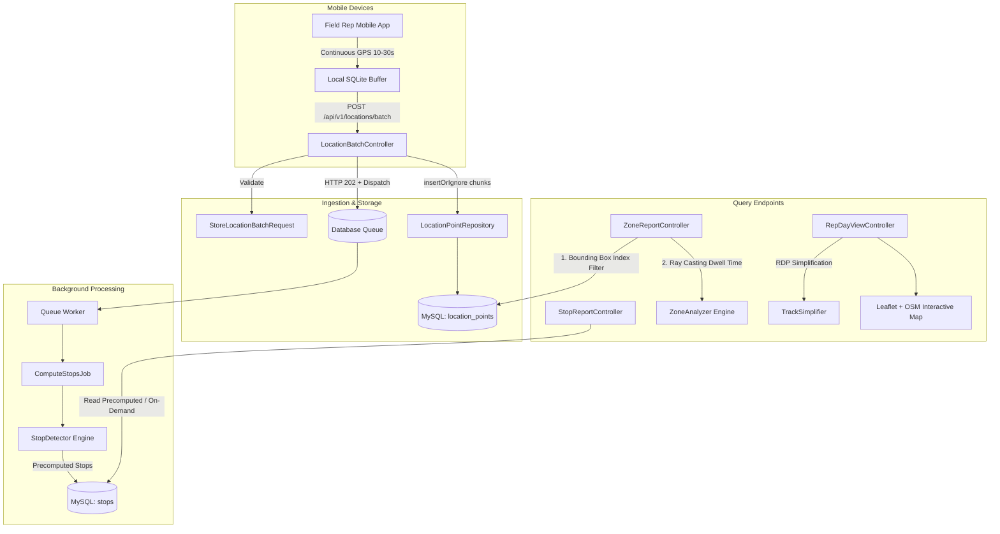

# Sales Representative Location Tracking System

A high-performance Laravel 12 application designed to ingest, process, and query continuous GPS location streams for field sales representatives with **zero data loss**, optimized storage, and sub-second query latency.

---

## Technical Overview & Architecture



### Architecture Highlights
1. **Thin Controller Pattern**: All controllers validate via Form Requests, delegate business logic to domain services (`StopDetector`, `ZoneAnalyzer`, `TrackSimplifier`) and repositories, and return typed API Resources.
2. **Asynchronous Background Processing**: Ingestion returns immediately with `HTTP 202 Accepted` after writing raw data. The heavy calculation of stationary stops is dispatched to background queued jobs (`ComputeStopsJob`), keeping mobile app API latency $< 30\text{ms}$.
3. **Dual Read Strategy**: The Stop Report reads precomputed stops from the indexed `stops` table for $O(1)$ lookups. If stops have not yet been processed by the queue worker, it falls back to real-time calculation from raw points on demand.

---

## Balancing Zero Data Loss with Storage Optimization

### 1. Guaranteeing Zero Data Loss
* **Local Device Buffering & At-Least-Once Delivery**: The mobile application writes points to local storage first and deletes them only upon receiving an HTTP 202 response from the server.
* **Server-Side Idempotency**: The `location_points` table enforces a composite unique constraint on `(rep_id, recorded_at)`. Ingestion uses `DB::table()->insertOrIgnore()`. If network instability causes the mobile device to resend the batch, duplicate points are safely ignored without throwing database errors or creating duplicate rows.
* **No Premature Downsampling**: Raw GPS points are never downsampled or dropped upon ingestion. Every point sent by the mobile device is persisted.

### 2. Storage & Query Optimization
* **Space-Efficient Column Types**:
  * Coordinates use `DECIMAL(9,6)`, providing precision down to ~11 cm while requiring only 5 bytes per coordinate (10 bytes total), compared to 16 bytes for `DOUBLE`.
  * `accuracy` is stored as `UNSIGNED SMALLINT` (2 bytes).
  * Removed Laravel's standard `created_at` and `updated_at` timestamps on `location_points`, saving 16 bytes per row. Over 10 million points, this directly saves **160 MB** of disk space and index overhead.
* **Denormalized Partition & Search Key (`recorded_date`)**:
  * Storing `recorded_date` (DATE) prevents the need for runtime SQL functions like `DATE(recorded_at)`, which would invalidate B-Tree index scans.
* **Composite Indexes**:
  * `(rep_id, recorded_date, recorded_at)`: Accelerates single-rep daily queries, chronological order scans, and streaming cursors.
  * `(recorded_date, lat, lng)`: Enables fast 2D rectangular bounding box pre-filtering for zone queries before running CPU-intensive ray-casting algorithms.
* **Memory-Safe Streaming (`lazy()` / `cursor()`)**: All point processing runs in constant memory ($O(1)$ RAM) via Laravel `LazyCollection`, preventing PHP memory exhaustion when handling millions of points.
* **Map Display Track Simplification**: The Ramer-Douglas-Peucker (RDP) algorithm in `TrackSimplifier` reduces polyline points by **~80%** before rendering the Leaflet web map, drastically decreasing browser DOM nodes and payload bandwidth.

### Optional: MySQL Partitioning by Range
For high-volume enterprise deployments, `location_points` can be partitioned by date:
```sql
-- In MySQL, every UNIQUE key must contain the partition column:
ALTER TABLE location_points DROP PRIMARY KEY, DROP INDEX location_points_rep_id_recorded_at_unique;

ALTER TABLE location_points
    ADD PRIMARY KEY (id, recorded_date),
    ADD UNIQUE KEY location_points_rep_date_time_unique (rep_id, recorded_date, recorded_at);

ALTER TABLE location_points PARTITION BY RANGE COLUMNS(recorded_date) (
    PARTITION p_2026_10_18 VALUES LESS THAN ('2026-10-19'),
    PARTITION p_2026_10_19 VALUES LESS THAN ('2026-10-20'),
    PARTITION p_future VALUES LESS THAN (MAXVALUE)
);
```

---

## Algorithms

1. **Stop Detection (`StopDetector`)**:
   * Uses a sliding **distance-from-anchor clustering** algorithm.
   * Cluster starts at anchor $P_0$. For each subsequent point $P_i$, great-circle distance $d = \text{haversine}(P_0, P_i)$ is computed.
   * If $d \le 50\text{ meters}$, $P_i$ extends the cluster.
   * If $d > 50\text{ meters}$ (or time gap $> 1800\text{s}$), the cluster closes. If duration $\ge 900\text{ seconds}$ (15 minutes), a stop is emitted with the centroid average coordinates. A new cluster starts at $P_i$.
   * A short 10-minute coffee pause correctly does **not** qualify as a stop.

2. **Point-in-Polygon (`Geo::pointInPolygon`)**:
   * Implements the **Jordan Curve Theorem (Ray Casting)** algorithm to determine if a point is inside an arbitrary polygon with $\ge 3$ vertices.
   * Accurately handles edge and vertex intersections.

3. **Zone Dwell Time (`ZoneAnalyzer`)**:
   * For consecutive chronological points $A \rightarrow B$, if $A$ is inside the polygon, the duration $(B.\text{time} - A.\text{time})$ is added.
   * To prevent device power-offs or signal outages inside a zone from exaggerating dwell time, each interval is capped at `zone_gap_cap_seconds` (default: 300 seconds).
   * Representatives with 0 seconds in the zone are excluded.

4. **Track Simplification (`TrackSimplifier`)**:
   * Implements the **Ramer-Douglas-Peucker (RDP)** algorithm. Recursively removes intermediate coordinates whose perpendicular distance to the segment line is less than $\epsilon$ (`rdp_tolerance`), preserving sharp corners and segment endpoints.

---

## API Documentation

All API routes are prefixed under `/api/v1` and require the `Accept: application/json` header.

### 1. Ingest Location Batch
* **Method**: `POST`
* **Route**: `/api/v1/locations/batch`
* **Status**: `202 Accepted`

```bash
curl -X POST http://127.0.0.1:8000/api/v1/locations/batch \
  -H "Accept: application/json" \
  -H "Content-Type: application/json" \
  -d '{
    "rep_id": 1,
    "points": [
      {
        "lat": 11.051234,
        "lng": 76.071234,
        "recorded_at": "2026-10-18T09:00:00Z",
        "accuracy": 5
      },
      {
        "lat": 11.051250,
        "lng": 76.071240,
        "recorded_at": "2026-10-18T09:00:15Z",
        "accuracy": 4
      }
    ]
  }'
```

**Response (202 Accepted):**
```json
{
  "accepted": 2,
  "inserted": 2,
  "duplicates": 0
}
```

---

### 2. Stop Report
* **Method**: `GET`
* **Route**: `/api/v1/reps/{rep}/stops?date=YYYY-MM-DD`
* **Status**: `200 OK` (or `404 Not Found` if rep does not exist, `422` if date invalid)

```bash
curl -X GET "http://127.0.0.1:8000/api/v1/reps/1/stops?date=2026-10-18" \
  -H "Accept: application/json"
```

**Response (200 OK):**
```json
{
  "rep_id": 1,
  "date": "2026-10-18",
  "stops": [
    {
      "lat": 11.054012,
      "lng": 76.073045,
      "started_at": "2026-10-18T10:30:00+00:00",
      "ended_at": "2026-10-18T10:55:00+00:00",
      "duration_minutes": 25,
      "duration_seconds": 1500
    }
  ]
}
```

---

### 3. Zone Dwell Time Report
* **Method**: `GET`
* **Route**: `/api/v1/zones/reps?date=YYYY-MM-DD&coordinates=[[lat,lng],...]`
* **Status**: `200 OK`

```bash
curl -G -H "Accept: application/json" "http://127.0.0.1:8000/api/v1/zones/reps" \
  --data-urlencode "date=2026-10-18" \
  --data-urlencode 'coordinates=[[11.050,76.068],[11.058,76.068],[11.058,76.078],[11.050,76.078]]'
```

**Response (200 OK):**
```json
{
  "data": [
    {
      "rep_id": 1,
      "name": "Rahul Nair",
      "seconds_in_zone": 2700,
      "minutes_in_zone": 45
    },
    {
      "rep_id": 2,
      "name": "Aisha Rahman",
      "seconds_in_zone": 1080,
      "minutes_in_zone": 18
    }
  ]
}
```

---

### 4. Interactive Web Map & Timeline (Nice-to-Have)
* **URL**: `http://127.0.0.1:8000/reps/1/day?date=2026-10-18`
* Features:
  * **Interactive Leaflet + OpenStreetMap** (no external API keys required).
  * Rep track plotted with RDP-simplified polyline.
  * Stop pins with 50-meter dashed boundary circles and duration popups.
  * Left-side chronological shift timeline; clicking any timeline item automatically centers and zooms the map.

---

## Local Setup & Evaluation Instructions

### Prerequisites
- PHP 8.2+ with `intl`, `pdo_mysql`, `sqlite3` extensions enabled.
- Composer 2+
- MySQL 8.0+

### Setup Commands
```bash
# 1. Install dependencies
composer install

# 2. Configure environment
cp .env.example .env
php artisan key:generate

# 3. Create the database in MySQL if not already existing:
# mysql -u root -e "CREATE DATABASE rep_tracker CHARACTER SET utf8mb4 COLLATE utf8mb4_unicode_ci;"

# 4. Migrate database and seed realistic demo tracking data
php artisan migrate:fresh --seed

# 5. Start the background queue worker (in a separate terminal)
php artisan queue:work

# 6. Start the local development server
php artisan serve
# Open http://localhost:8000 in your browser
```

### Running Tests
All unit and feature tests use in-memory SQLite and require no manual test database configuration:
```bash
php artisan test
```

### Code Formatting (Laravel Pint)
```bash
./vendor/bin/pint --test
```

### Generating Realistic Shifts (Artisan Simulator)
```bash
php artisan tracking:simulate {rep_id_or_name} {YYYY-MM-DD}

# Example:
php artisan tracking:simulate 1 2026-10-18
```

---

## Assumptions

1. **UTC Standard**: All timestamps are ingested, stored, and calculated in **UTC**. The denormalized `recorded_date` represents the UTC date.
2. **Zone Representation**: Coordinates are supplied as an array of at least 3 `[lat, lng]` pairs passed as a JSON query string.
3. **Stationary Definition**: A representative is considered stationary if they stay within a **50-meter radius** of an anchor point for **15 minutes (900 seconds) or longer**.
4. **Device Ping Interval**: Mobile devices are assumed to ping every 10–30 seconds.
5. **Outage Cap**: Consecutive points within a zone separated by more than 300 seconds are clamped to 300 seconds to prevent device power-off or tunnel signal loss from artificially exaggerating on-site dwell time.
6. **Authentication**: Authentication is excluded from technical assessment scope per specification; `laravel/sanctum` is installed and ready for production API token issuance.

---

## GitHub Collaborator Access

Access to this private GitHub repository should be granted to:
- `shansalam`
- `hasiashiana`
- `mnoufal369`
